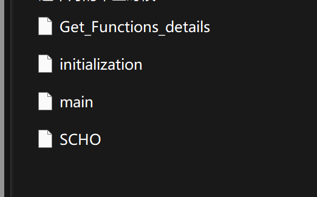

# [2023 October Update] Dual-Curvature Cosine Optimization Algorithm (Matlab Code Implementation)

[October 2023: The latest optimization algorithm]Hyperbolic Cosine Optimization Algorithm (Matlab code implementation)

## Images

<!-- PAYMENT_BLOCK -->

## Get this dataset

- Payment link (Stripe): [Buy now](https://buy.stripe.com/3cs8yP7sY87d0vu9AB)
- Payment QR code: 

<!-- /PAYMENT_BLOCK -->
